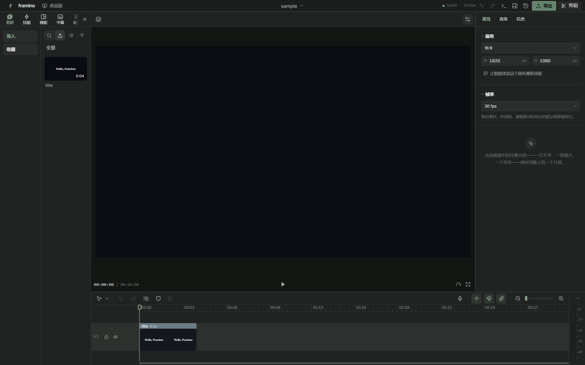

<p align="center">
  <br>
  
  
</p>

<h3 align="center">AI Video Production Studio</h3>

<p align="center">AI creates. Humans refine. Framino brings everything together.</p>

<p align="center"><b>English</b> · <a href="README.zh-CN.md">简体中文</a></p>



## About

Framino is a professional video production studio that combines AI-powered creation with human-controlled editing.

Your own coding agent — Codex, Claude Code, or anything that can read a folder — writes the film: the script, the
shots, the generated media, the assembly. You then open Framino Studio and work on it like an editor does: trim on
the timeline, move and scale what is in the picture, rewrite subtitles, set levels, watch it, export it.

Both sides work on **one project on disk**. The agent writes files; Studio reads and writes the same files. There is
no cloud project, no import step, no second copy that can drift.

- **One project, one format.** A folder with a `film.html`: tracks of clips, cut together, styled with CSS. The agent
  already knows the web, so nothing new has to be learned.
- **One real editor.** A dark, dense, professional workspace — media library, monitor, inspector, multi-track
  timeline — not a dashboard of AI cards.
- **One honest boundary.** What the editor can do, it really does. What is not connected says so.

## Studio

A local editor that runs in your browser (Chromium-based: Chrome or Edge — the same engine films are drawn and
exported with, so the preview is what you export).

| Region | What it is |
| --- | --- |
| Top toolbar | project, real save state, undo/redo, Agent, layout, versions, Export |
| Left | media library: footage, images, audio, generated clips, subtitles, templates |
| Center | preview monitor: the picture at its own aspect ratio, never cropped or stretched |
| Right | inspector: transform, video, audio and text properties of what is selected |
| Bottom | timeline: ruler, playhead, video/audio/text tracks, clips, waveforms, zoom |

Everything is editable: text and layers inside the picture, clips on the timeline, their place, look, volume and
speed, and the subtitles. Edits are written to the film's files immediately, so the agent sees them and keeps them.

Export what the project is now: video, GIF, audio or stems, subtitles, stills, a transparent video, or the timeline
itself for Final Cut Pro, Premiere Pro and DaVinci Resolve. The project and its media stay where they are.

## Agent and Studio

**Agent mode** — the agent creates and changes the project.
**Studio mode** — you review and edit by hand.
Both operate the same `film.html`, so a change made by one is the state the other reads.

The toolbar's **Agent** button opens a side panel that shows the project's real state (tracks, clips, revision read
from disk) and the real event stream (film writes, exports, files, canvas, history). Where a conversation exists — the
desktop app — the panel opens it. In the browser Studio there is no chat of its own, and the panel says exactly that:
an instruction composed there is copied for your coding agent, never pretended to have run.

To drive it from a terminal or an agent:

```sh
openfilm open "/path/to/project"     # Studio opens on it
```

## Install

Requires Node 22.18+, pnpm 9 and git; ffmpeg for rendering. The first render downloads a headless Chromium
(about 100 MB).

```sh
git clone https://github.com/aircrushin/Framino && cd Framino
corepack enable
pnpm install
pnpm dev            # Studio from this checkout, with a sample film
```

`pnpm dev` prints the Studio address and opens it. `OPENFILM_NO_BROWSER=1 pnpm dev` keeps it from opening a window.

The desktop app — Studio with a chat beside it for Claude Code, Codex and the other agents — runs from source with
`pnpm dev:desktop`.

## Commands

The CLI keeps its original name, so agents, skills and existing scripts keep working.

```sh
openfilm                          # what a film is, and the built-in skills: where an agent starts
openfilm open   [folder | url]    # show a film in Studio: a new one, an existing one, one from GitHub
openfilm look   [what] [t | a-b]  # check the film, a page or a media file: contact sheet, one frame, or a range
openfilm render [a-b]             # the MP4; --4k, --blur, --alpha, --loudness=-14
openfilm get    [what]            # media: the bundled CC0 library first, else a connected service
openfilm canvas [apply <steps>]   # the canvas beside the edit
openfilm skills                   # the skills a film can be made with
openfilm doctor                   # what this computer has, to paste into an issue
```

## Skills

How a film is made lives in skills, not in the tool. `openfilm` prints one page: what a film is, and the built-in
skills — `edit` (the project, `film.html` and pages, and checking them), `media` (the library and the services) and
`canvas`. An agent reads the one a task needs with `openfilm skill <name>`.

## How it works

A film is a folder with a `film.html`: tracks of clips cut together.

```html
<meta name="viewport" content="width=1920, height=1080">
<style>
  .card { object-fit: cover; border-radius: 24px; }
</style>
<section>
  <iframe src="title.html#t=0,4"></iframe>
</section>
<section>
  <video src="assets/footage.mp4#t=12,18" at="4" speed="0.5" class="card" style="left: 160px; top: 90px; width: 1600px; height: 700px"></video>
</section>
<section>
  <audio src="assets/music.mp3" volume="0.6"></audio>
</section>
```

Each `<section>` is a track, in the order the timeline shows them. A clip is an element: a page, a video, a still
picture or a sound. Which part of its file plays is a media fragment (`#t=12,18`), where it starts is `at`, where it
sits is its style's `left`, `top`, `width` and `height`. `overrides` hold your changes to elements of a page, and
agents keep them when they edit.

A page draws any moment of itself, and that is the whole contract:

```html
<script type="module">
window.film = {
  frame(t) { /* draw the complete picture at t seconds, with anything */ },
  duration: 4,               // optional: its own length, in seconds
  ready: loadFonts(),        // optional: a Promise for fonts, images, models, data
  width: 480, height: 320,   // optional: a page that is only a part of the picture
};
</script>
```

**The one rule:** the same `t` always draws the same picture, whatever was drawn before.

[MANUAL.md](packages/openfilm/MANUAL.md) is the page `openfilm` prints, and
[packages/openfilm/manual](packages/openfilm/manual) holds the built-in skills;
[SPEC.md](packages/openfilm/SPEC.md) is for anyone building a player, renderer or editor.

## Documentation

| Document | What it covers |
| --- | --- |
| [FRAMINO_CONTEXT.md](FRAMINO_CONTEXT.md) | product context for every agent: what Framino is, the workflow, the phase, what the code already does |
| [AGENTS.md](AGENTS.md) | rules for every coding agent (Claude Code reads it through `CLAUDE.md`) |
| [docs/FRAMINO_ARCHITECTURE.md](docs/FRAMINO_ARCHITECTURE.md) | the real architecture and where the Phase 2 modules plug in |
| [docs/FRAMINO_INTEGRATION_CONTRACT.md](docs/FRAMINO_INTEGRATION_CONTRACT.md) | IDs, the Production Manifest, errors and ownership shared by the Phase 2 modules |
| [docs/FRAMINO_NEXT_PLAN.md](docs/FRAMINO_NEXT_PLAN.md) | the Phase 2 execution order, verified against the code at `d63f7ef` |
| [docs/FRAMINO_ARCHITECTURE_AUDIT.md](docs/FRAMINO_ARCHITECTURE_AUDIT.md) | the inherited architecture: modules, project format, save/export flow, what may not be touched |
| [docs/FRAMINO_DESIGN_SYSTEM.md](docs/FRAMINO_DESIGN_SYSTEM.md) | tokens, type, geometry, component rules of the studio |
| [docs/FRAMINO_IMPLEMENTATION_REPORT.md](docs/FRAMINO_IMPLEMENTATION_REPORT.md) | what this phase changed, what was verified, what is not done |
| [CONTRIBUTING.md](CONTRIBUTING.md) | each package, and how to work on it |

## From source

You need Node 22.18 or later, pnpm 9 (`corepack enable` gives you the version this repository names), ffmpeg on the
PATH, and git.

```sh
pnpm install
pnpm dev            # Studio from this checkout, with a sample film
pnpm typecheck
pnpm build
pnpm test
```

Tell your coding agent to run `packages/openfilm/.dev/bin/openfilm` and it makes films with your checkout, in that
Studio.

## Upstream and license

Framino is a fork of **[OpenFilm](https://github.com/openfilm/openfilm)** (MIT), and inherits its format, CLI, engine
and Studio. The upstream repository is kept as the `upstream` remote so improvements can be merged:

```sh
git fetch upstream && git merge upstream/main
```

The film format, the CLI (`openfilm`), the skills and the project files are unchanged, so projects, agents and
skills written for OpenFilm work here as they are. The `openfilm` command name, package name, environment variables
and project fields are intentionally **not** renamed: they are compatibility surface, not branding.

The original copyright, the [LICENSE](LICENSE) and the [third-party notices](THIRD_PARTY_NOTICES.md) are kept in
full. The OpenFilm name and logo remain the OpenFilm project's trademarks (see [TRADEMARK.md](TRADEMARK.md)) and are
not used as Framino's own brand. The bundled media library is the OpenFilm contributors' CC0 library and is credited
as such.

Framino's own name, wordmark and palette are its brand; the interface is a redesign, not a copy of any other
editing application.
