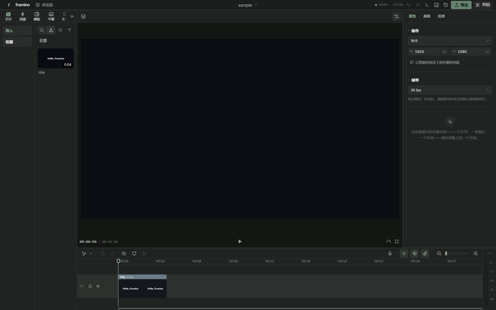

<p align="center">
  <br>
  
  
</p>

<h3 align="center">AI 视频制作工作台</h3>

<p align="center">AI 负责创作，人来精修，Framino 把两者合到一起。</p>

<p align="center"><a href="README.md">English</a> · <b>简体中文</b></p>



## 关于

Framino 是一个把 AI 创作与人工精修合在一起的专业视频制作工作台。

你自己的 coding agent（Codex、Claude Code，或任何能读写文件夹的 agent）负责创作：脚本、分镜、素材、组装。之后你打
开 Framino Studio，像剪辑师一样工作：在时间线上裁剪，在画面里移动和缩放元素，改写字幕，调音量，预览，导出。

两边操作的是**磁盘上的同一个项目**。agent 写文件，Studio 读写同一批文件。没有云端项目，没有导入步骤，不会出现
第二份会对不上的数据。

- **一个项目、一种格式。** 一个装着 `film.html` 的文件夹：多条轨道上的片段，用 CSS 排版。agent 本来就懂 Web。
- **一个真正的编辑器。** 深色、紧凑、专业的编辑台：素材库、监视器、属性检查器、多轨时间线。
- **一条诚实的边界。** 编辑器能做的一定真的能做；没接上的部分会明确说明，而不是假装完成。

## 编辑台

在本地浏览器中运行（Chromium 内核：Chrome 或 Edge，与渲染导出用的是同一个引擎，所以预览就是导出结果）。

| 区域 | 内容 |
| --- | --- |
| 顶部工具栏 | 项目、真实的保存状态、撤销/重做、Agent、布局、版本、导出 |
| 左侧 | 素材库：视频、图片、音频、生成片段、字幕、模板 |
| 中间 | 预览监视器：按原始宽高比显示，不拉伸、不裁剪 |
| 右侧 | 属性检查器：所选对象的变换、视频、音频、文字属性 |
| 底部 | 时间线：刻度、播放头、视频/音频/文字轨道、片段、波形、缩放 |

画面里的文字与图层、时间线上的片段、它们的位置、外观、音量与速度、字幕，全部可以修改。修改会立即写入项目文件，
agent 能读到并保留。

导出的是项目当前的状态：视频、GIF、音频或分轨、字幕、静帧、透明视频，或供 Final Cut Pro / Premiere Pro /
DaVinci Resolve 使用的时间线。项目源文件与原始素材始终保留。

## Agent 与 Studio

**Agent 模式**：AI 生成和修改项目。
**Studio 模式**：你审查并手动编辑。
两者操作同一个 `film.html`，一方改动就是另一方读到的状态。

工具栏的 **Agent** 按钮打开侧边面板，显示项目真实状态（轨道、片段、来自磁盘的版本）和真实事件流（项目写入、导出、
文件、画布、历史）。有对话能力的环境（桌面端）会直接打开对话；浏览器版 Studio 自身没有对话，面板会明确说明：
在这里编写的指令只会被复制给你的 coding agent，不会伪装成已执行。

## 安装

需要 Node 22.18+、pnpm 9、git；渲染需要 ffmpeg。首次渲染会下载约 100 MB 的无头 Chromium。

```sh
git clone https://github.com/aircrushin/Framino && cd Framino
corepack enable
pnpm install
pnpm dev            # 用当前代码启动 Studio，并打开一个示例影片
```

`pnpm dev` 会打印 Studio 地址并打开它。设置 `OPENFILM_NO_BROWSER=1 pnpm dev` 可阻止自动打开窗口。

带对话栏的桌面端（Claude Code、Codex 等）可用 `pnpm dev:desktop` 从源码启动。

## 命令

CLI 保留原有名称，agent、skills 与既有脚本无需改动。

```sh
openfilm                          # 影片是什么，以及内置 skills：agent 从这里开始
openfilm open   [folder | url]    # 在 Studio 中打开影片：新建、已有，或来自 GitHub
openfilm look   [what] [t | a-b]  # 检查影片、页面或媒体文件：联系表、单帧或区间
openfilm render [a-b]             # 导出 MP4；--4k、--blur、--alpha、--loudness=-14
openfilm get    [what]            # 素材：先用内置 CC0 库，否则调用已连接的服务
openfilm canvas [apply <steps>]   # 影片旁边的画布
openfilm skills                   # 可以用于制作影片的 skills
openfilm doctor                   # 检查本机环境，方便贴进 issue
```

## Skills

影片怎么做，写在 skills 里，而不在工具里。`openfilm` 会打印一页说明：影片是什么，以及内置 skills —— `edit`
（项目、`film.html` 与页面，以及如何检查）、`media`（素材库与服务）、`canvas`。agent 通过
`openfilm skill <name>` 读取需要的那个。

## 它是怎么工作的

一部影片就是一个装着 `film.html` 的文件夹：多条轨道上的片段拼在一起。

```html
<meta name="viewport" content="width=1920, height=1080">
<section>
  <iframe src="title.html#t=0,4"></iframe>
</section>
<section>
  <video src="assets/footage.mp4#t=12,18" at="4" speed="0.5" style="left: 160px; top: 90px; width: 1600px; height: 700px"></video>
</section>
<section>
  <audio src="assets/music.mp3" volume="0.6"></audio>
</section>
```

每个 `<section>` 是一条轨道。片段就是一个元素：页面、视频、图片或声音。播放它的哪一段由媒体片段
（`#t=12,18`）决定，起点是 `at`，位置由样式的 `left`、`top`、`width`、`height` 决定。

页面自己画出任意时刻，这就是全部契约：

```html
<script type="module">
window.film = {
  frame(t) { /* 画出 t 秒时的完整画面 */ },
  duration: 4,               // 可选：自身长度（秒）
  ready: loadFonts(),        // 可选：字体、图片、模型、数据的 Promise
};
</script>
```

**唯一的规则：** 同一个 `t` 永远画出同一张画面，不管之前画过什么。

## 文档

| 文档 | 内容 |
| --- | --- |
| [docs/FRAMINO_ARCHITECTURE_AUDIT.md](docs/FRAMINO_ARCHITECTURE_AUDIT.md) | 继承来的架构：模块、项目格式、保存与导出流程、不可修改的部分 |
| [docs/FRAMINO_DESIGN_SYSTEM.md](docs/FRAMINO_DESIGN_SYSTEM.md) | 设计令牌、字体、尺寸、组件规则 |
| [docs/FRAMINO_IMPLEMENTATION_REPORT.md](docs/FRAMINO_IMPLEMENTATION_REPORT.md) | 本阶段改了什么、验证了什么、什么还没做 |

## 上游与许可

Framino 是 **[OpenFilm](https://github.com/openfilm/openfilm)**（MIT）的 Fork，继承了它的格式、CLI、渲染引擎与
Studio。上游仓库保留为 `upstream` remote，便于合并改进：

```sh
git fetch upstream && git merge upstream/main
```

影片格式、CLI（`openfilm`）、skills 与项目文件均未改变，因此为 OpenFilm 写的项目、agent 与 skills 在这里可以直接
使用。`openfilm` 命令名、包名、环境变量与项目字段**刻意不改**：它们是兼容性接口，不是品牌。

原版权声明、[LICENSE](LICENSE) 与[第三方声明](THIRD_PARTY_NOTICES.md) 完整保留。OpenFilm 的名称与 Logo 仍属
OpenFilm 项目的商标（见 [TRADEMARK.md](TRADEMARK.md)），不作为 Framino 自有品牌使用。内置素材库是 OpenFilm
贡献者的 CC0 素材库，并按其要求署名。

Framino 自己的名称、字标与配色属于 Framino；界面是重新设计，不复制任何其他剪辑软件的界面。
